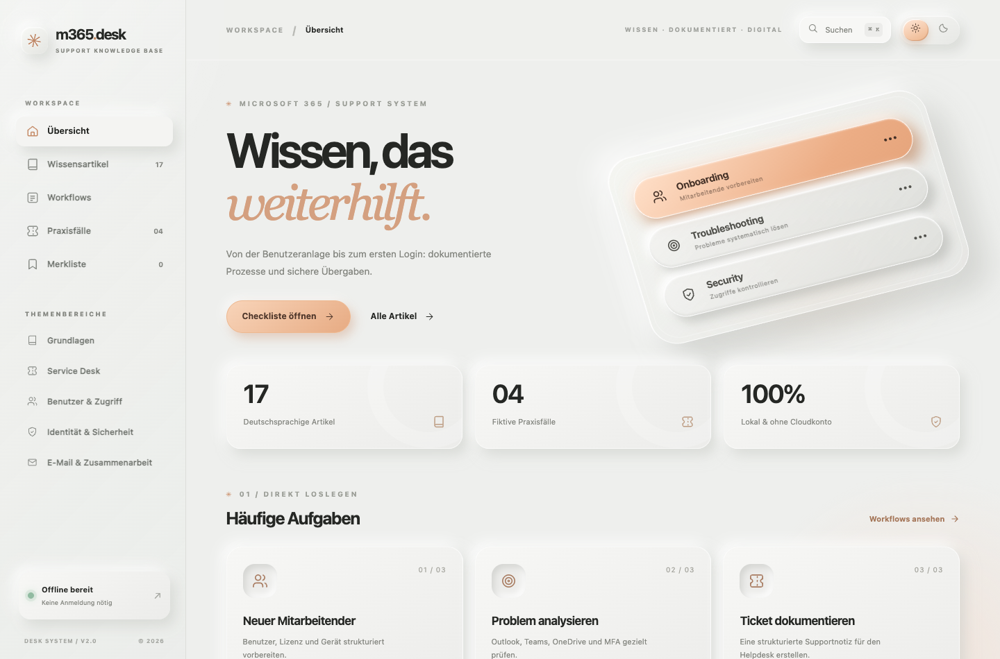

# m365.desk — Microsoft 365 Support Knowledge Base

<!-- BEGIN: REAL APPLICATION PREVIEW -->

## Interface preview / Benutzeroberfläche



> Screenshot captured from the **running application with fictional/demo data**. This is a locally hosted portfolio demo, not a production deployment. / *Echter Screenshot aus der lokal gestarteten Demo mit Beispieldaten.*

<!-- END: REAL APPLICATION PREVIEW -->

<!-- BEGIN: INTERNATIONAL PORTFOLIO SUMMARY -->

[](https://github.com/muratpalak/Microsoft-365-Support-Knowledge-Base/actions/workflows/pages.yml)

**International portfolio overview / Internationale Projektübersicht**

**EN:** German-language, offline-capable knowledge base with support playbooks, search, checklists and case examples. **Tech:** Microsoft 365 workflows · German documentation · HTML/JS. This is a portfolio/demo project; read its limitations before real-world use.

**DE:** Deutschsprachige, offline nutzbare Knowledge Base mit Supportleitfäden, Suche, Checklisten und Fallbeispielen.

**[Technical case study / Technische Projektbeschreibung](docs/PORTFOLIO_CASE_STUDY.md)** · [Documentation publish](https://github.com/muratpalak/Microsoft-365-Support-Knowledge-Base/actions/workflows/pages.yml)

<!-- END: INTERNATIONAL PORTFOLIO SUMMARY -->


**Version 2.0 · Deutschsprachiges IT-Support-Portfolio-Projekt · Offline nutzbar**

Eine eigenständig entwickelte, minimalistische Wissensdatenbank für typische Microsoft-365-Supportprozesse. Das Design orientiert sich an **Soft-Glass-UI**, transparenten, erhöhten Segment-Controls, reduzierten Grautönen, warmen Apricot-Akzenten und ruhiger Typografie.

> **Portfolio- und Demonstrationsprojekt** – kein echtes Helpdesk-System, kein Microsoft-365-Tenant-Zugang, keine Kontoänderungen und keine Microsoft-Partnerschaft.

## Sofort öffnen — macOS

1. ZIP-Datei entpacken.
2. Den Ordner `Microsoft-365-Support-Knowledge-Base` öffnen.
3. `START_HIER.html` doppelklicken. Alternativ `site/index.html` in Safari oder Chrome öffnen.

**Es sind keine Installation, Python-Pakete, Terminal-Befehle, Server oder Logins nötig.** Die Website funktioniert lokal auch ohne Internet.

## Was die Anwendung bietet

| Bereich | Funktion |
| --- | --- |
| Startseite | Interaktives dreistufiges Soft-Glass-Control für Onboarding, Troubleshooting und Security |
| 17 Fachartikel | Volltextsuche, Kategoriefilter, Inhaltsverzeichnisse, Querverweise und Druckansicht |
| Merkliste | Artikel lokal als Favoriten markieren, gespeichert im Browser |
| Onboarding | Interaktive Checkliste mit 14 Schritten, Fortschrittsanzeige und TXT-Export |
| Erstdiagnose | Auswahl des betroffenen Dienstes und kontextbezogene, sichere erste Prüfschritte |
| Ticket-Vorlage | Formular zur Erstellung, Kopie und TXT-Ausgabe strukturierter Ticketnotizen |
| Praxisfälle | Vier **fiktive** Supportfälle mit Verknüpfung zur Ticketvorlage |
| UI | Responsive Design, Hell-/Dunkelmodus, Tastatur-Suche `⌘K` bzw. `Ctrl+K` |

**Datenschutz:** Suche, Filter und Checklisten laufen ausschließlich lokal; die Anwendung sendet keine Daten ins Internet. Browser-Favoriten und Checklistenstand werden bei verfügbarer Browser-Speicherung lokal gespeichert. Eingegebene Tickettexte werden nicht automatisch dauerhaft gespeichert.

## Themen der 17 Artikel

- Grundlagen, Ticketprozess und Service-Desk-Praxis
- Einrichtung neuer Mitarbeitender, Benutzerkonten und Lizenzen
- Anmeldung, MFA und Kennwortprobleme
- Outlook, Exchange Online, Shared Mailbox und Message Trace
- Microsoft Teams, OneDrive und SharePoint
- Offboarding, Service Health, Datenschutz und Eskalation
- Vier fiktive Fälle mit Diagnose, Maßnahme und simuliertem Test

Die Artikel erklären Voraussetzungen, Prüfschritte, Lösungswege, Dokumentation und Eskalation. Offizielle Microsoft-Learn-Links befinden sich in den Markdown-Quelldateien, wo sinnvoll.

## Projektstruktur

```text
Microsoft-365-Support-Knowledge-Base/
├── START_HIER.html                 # Start per Doppelklick
├── KURULUM_TR.md                   # Türkische Kurzanleitung
├── README.md                       # Diese Projektbeschreibung
├── docs/                           # 17 Artikel: Markdown + Metadaten
├── examples/                       # Demo-Tickets und Vorlagen
├── scripts/
│   ├── build_site.py               # Offline-Site aus Artikeln bauen
│   └── template.html               # HTML-Grundstruktur der App
├── site/                            # Fertige App; direkt starten
│   ├── index.html
│   ├── assets/
│   │   ├── app.js
│   │   ├── style.css
│   │   └── favicon.svg
│   └── 000-start.html ...           # Weiterleitungen alter Links
├── requirements.txt                # Nur für die Inhaltsbearbeitung
└── .github/workflows/pages.yml     # GitHub Pages Deployment
```

## Fachartikel bearbeiten und Site neu bauen

Hierfür werden einmalig Python 3 sowie die Pakete aus `requirements.txt` benötigt:

```bash
cd ~/Desktop/Microsoft-365-Support-Knowledge-Base
python3 -m venv .venv
source .venv/bin/activate
python -m pip install -r requirements.txt
python scripts/build_site.py
open site/index.html
```

Für die **normale Nutzung** ist keiner dieser Schritte erforderlich. Artikel liegen editierbar in `docs/*.md`. Die App bettet die Artikel beim Build in die HTML-Datei ein und benötigt zur Laufzeit keinen Server.

## Auf GitHub Pages veröffentlichen

1. Öffentliches Repository `microsoft-365-support-knowledge-base` erstellen.
2. Den vollständigen Projektordner (ohne `.venv`) hochladen.
3. Auf GitHub **Settings → Pages → Source → GitHub Actions** auswählen.
4. Bei jedem Push auf `main` baut `.github/workflows/pages.yml` die fertige Website aus dem Markdown neu und veröffentlicht sie unter GitHub Pages.

## Lebenslauf — Projektbeschreibung

**Microsoft 365 Support Knowledge Base — Eigenständiges Portfolio-Projekt (2026)**  
Entwicklung einer deutschsprachigen, responsiven IT-Support-Wissensdatenbank mit 17 Fachartikeln, Onboarding-Workflow, Benutzer- und Lizenzverwaltung, Microsoft-365-Troubleshooting sowie vier simulierten Support-Fällen. Technische Umsetzung mit HTML, CSS, JavaScript und Markdown, inklusive lokaler Suche und GitHub-Pages-Deployment.

## Wichtige Hinweise

- **Kein reales Administrationswerkzeug:** Die Oberfläche verwaltet keine echten Benutzer, Rollen, Lizenzen oder MFA-Methoden.
- **Simulierte Supportfälle:** Weder diese Tickets noch deren Lösungen stellen nachgewiesene praktische Berufserfahrung dar.
- **Active Directory:** Es wird keine Erfahrung mit lokalem Active Directory behauptet.
- **Aktualität:** Microsoft-Menüs und Lizenzen können sich ändern. Vor produktiven Eingriffen offizielle Microsoft-Learn-Dokumentation, Freigaben und interne Sicherheitsrichtlinien prüfen.
- **Vertraulichkeit:** Keine echten Passwörter, MFA-Codes oder sensitiven Personendaten in Demo-Formulare eingeben.
- Microsoft 365, Teams, Outlook, SharePoint, OneDrive und Exchange sind Marken ihrer jeweiligen Rechteinhaber. Keine offizielle Verbindung zu Microsoft.

**Inhaltlich überarbeitet:** 20. Oktober 2026 · **Lizenz:** MIT (`LICENSE`).
