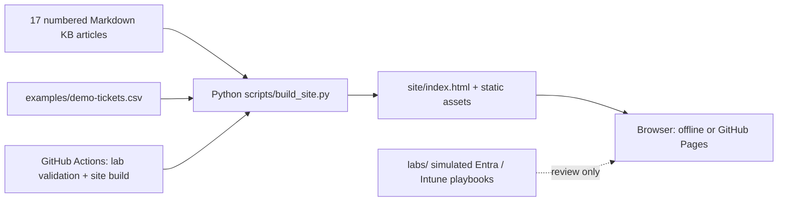

# Architecture — m365.desk / Support Knowledge Base

**Scope:** German-language, offline-capable documentation. This is not a Microsoft 365 administration client.

## Components

- `docs/000-*.md` through `docs/160-*.md`: knowledge articles with YAML front matter. Only the **numbered** article files are converted to searchable HTML.
- `scripts/build_site.py`: reads Markdown and a synthetic ticket CSV, then generates the offline HTML entry point.
- `site/`: generated client-only output, published by GitHub Pages.
- `labs/`: **paper/simulated** scenario exercises for Microsoft 365, Entra ID and Intune; not tenant actions, device enrollment or admin automation.
- `.github/workflows/pages.yml`: validation, build and publication workflow.

## Threat model / boundaries

No authentication, Microsoft Graph calls, tenant tokens or privileged operations are part of the static site. Do not enter real usernames, secrets or MFA codes in examples. Documentation may not match every tenant policy or licensing tier, so operational use requires current official docs and local admin approval.
